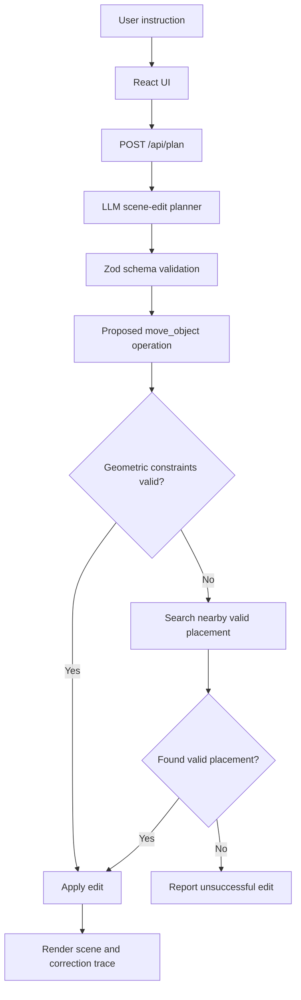

<div align="center">

# SceneCraft

### Geometry-Aware Agentic Editing for 3D Scenes

**Language-guided 3D scene editing with explicit geometric validation and automatic placement correction.**

 [How It Works](#how-it-works) · [Run Locally](#run-locally) · [Research Direction](#research-direction) · [Roadmap](#roadmap)

</div>

> **Research prototype (v0.2).** SceneCraft explores a focused question: **Can deterministic geometry checks improve the spatial validity of edits proposed by a language model?** This is an engineering MVP and exploratory research direction, not a trained 3D foundation model or a published research result.
>
> 


## Overview

Language models can translate high-level instructions into scene-editing commands, but the resulting placements may violate simple physical constraints: objects can overlap, leave the room, or obstruct an entrance.

SceneCraft separates **semantic planning** from **geometric execution**. A language model proposes a structured object move. A deterministic geometry engine evaluates the placement and either accepts it or searches for an alternative valid position. The app renders the updated room and shows a correction trace.

**Example:**

> “Move the bookshelf near the doorway.”

The planner proposes a location. If that position violates entrance clearance or collides with another object, the geometry layer attempts to find a nearby valid placement and reports the result.


## Features

- **Interactive 3D room** — a furnished scene rendered with React Three Fiber and Three.js.
- **Language-guided planning** — an OpenAI-compatible chat model converts an instruction and scene snapshot into a structured edit proposal.
- **Strict operation schema** — Zod validation constrains model output to a supported operation.
- **Deterministic geometric validation** — checks axis-aligned bounding-box collisions, room bounds, and protected entrance clearance.
- **Automatic placement correction** — a bounded local search attempts to repair invalid positions.
- **Explainable correction trace** — displays what was proposed and what the geometry layer changed.
- **Offline baseline mode** — a deterministic rule-based planner for local demos without a model API key.
- **Automated tests** — unit tests for operations and geometric invariants.

## How It Works



### Core principle: the model proposes; geometry verifies

The language model **does not** execute arbitrary code or directly modify the scene. Its proposal must pass structured validation, and the geometry engine determines the accepted placement. This provides a simple, auditable boundary between probabilistic planning and explicit spatial constraints.

### Geometry model

The current prototype uses:

- Axis-aligned bounding boxes (AABBs) for furniture overlap detection
- Room-boundary constraints
- A protected doorway/entrance area
- A bounded radial-grid search for alternative object positions

This is intentionally lightweight. It is not a physics engine, differentiable renderer, global optimizer, or complete navigation validator.

## Tech Stack

| Layer | Technology |
| --- | --- |
| Frontend | React 19, TypeScript, Vite |
| 3D rendering | Three.js, React Three Fiber, Drei |
| API | Node.js, Express |
| LLM planning | OpenAI-compatible chat-completions API |
| Validation | Zod |
| Geometry | TypeScript geometric predicates and bounded local search |
| Tests | Vitest |

## Run Locally

**Requirements:** Node.js 20+, npm, and optionally an API key for the LLM planner.

```bash
npm install
cp .env.example .env
```

Configure `.env`:

```dotenv
OPENAI_API_KEY=your_api_key_here
OPENAI_MODEL=gpt-4.1-mini
OPENAI_BASE_URL=https://api.openai.com/v1
PORT=8787
```

**Important:** Never commit `.env` or expose `OPENAI_API_KEY` in frontend code or a `VITE_` variable.

Start the frontend and API together:

```bash
npm run dev
```

Open the local Vite URL printed in the terminal. To confirm the API is running, visit:

```text
http://localhost:8787/api/health
```

If you do not have an API key, select **Deterministic V1 baseline** in the interface.

### Quality checks

```bash
npm run typecheck
npm test
npm run build
```

## Repository Structure

```text
server/
  index.ts                 # HTTP endpoint and request validation
  planner.ts               # LLM provider adapter and response handling
src/
  components/World.tsx     # 3D visualization
  domain/geometry.ts       # Scene data, collision checks, baseline planner
  domain/operations.ts     # Operation contracts and correction engine
  hooks/useSceneEditor.ts  # Editing state and asynchronous orchestration
  lib/plannerClient.ts     # Typed planner API client
  App.tsx                  # UI composition
  style.css                # Styles
tests/
  operations.test.ts       # Geometric and operation invariants
```

## Research Direction

**Question:** Can deterministic geometric verification improve constraint satisfaction in language-guided 3D scene edits while preserving instruction intent?

### Planned evaluation

Use a reproducible set of instructions across spatial scenarios such as object collisions, room-boundary violations, doorway obstruction, and valid object relocations. For each fixed scene and model-generated proposal, compare:

1. **Raw LLM proposal** — the operation before geometric correction.
2. **Verified proposal** — the same operation after constraint checking and any repair.

Measure:

- **Geometric validity:** fraction of edits meeting all implemented constraints
- **Instruction satisfaction:** fraction of edits achieving the intended target relationship
- **Repair success rate:** fraction of invalid proposals successfully repaired
- **Edit preservation:** whether unrelated objects remain unchanged
- **Latency:** planner and geometric correction time

**No quantitative performance claims are reported yet.** Results will be published with benchmark definitions, prompts, model settings, and reproduction steps once available.

## Limitations

- Supports one `move_object` proposal per request; it does not yet support multiple edits, asset generation, or general scene creation.
- Collision checking uses AABBs rather than detailed mesh geometry.
- Automatic repair uses a local heuristic and can fail; it does not guarantee a globally optimal placement.
- The interface operates on a constrained room with a known object inventory.
- There is no full physics simulation, path planning, learned 3D representation, or photorealistic generation.
- Current API server is a local-development prototype. It is **not production-hardened**: public deployment requires rate limiting, authentication or abuse controls, request budgets, origin restrictions, and a server-authoritative approach to scene validation.

## Roadmap

- [x] Interactive 3D scene
- [x] Structured language-model edit proposals
- [x] Geometry checks and automatic placement correction
- [x] Deterministic baseline mode and unit tests
- [ ] Reproducible spatial-edit benchmark and evaluation results
- [ ] Before / proposed / corrected visual comparison
- [ ] Multi-object edits and more expressive spatial instructions
- [ ] More precise geometry and scene representations
- [ ] Reliable public deployment with server-side secret management and abuse protection

## Motivation

SceneCraft is a personal exploratory project at the intersection of **agentic graphics, spatial reasoning, and controllable 3D interaction**. The longer-term goal is to investigate how language-guided visual creation systems can combine flexible model-driven planning with grounded geometric constraints.

